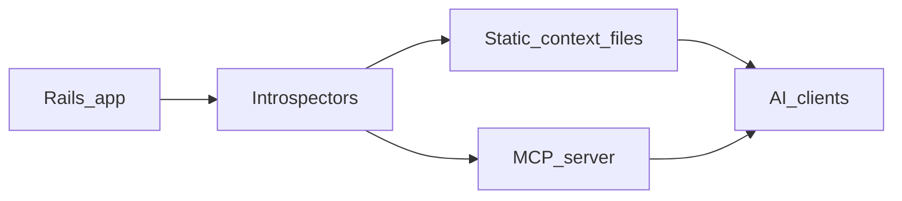

# rails-ai-bridge


> Maps your Rails app so assistants stop guessing table names, routes, and conventions.

The install generator writes compact context files and starts a read-only MCP server. Assistants can read the files at session start, then ask for one model, table, or controller when they need detail.

[](https://rubygems.org/gems/rails-ai-bridge)
[](https://github.com/igmarin/rails-ai-bridge/actions)
[](LICENSE)

[](https://deepwiki.com/igmarin/rails-ai-bridge)
[](docs/mcp-registry-submission.md)

---

## What this gem does

AI assistants lack project-specific context, leading to guessed table names, missed routes, and wasted tokens.
rails-ai-bridge turns a Rails app into an AI-readable project map:

- **Static context files** give assistants an immediate overview of your app, conventions, schema shape, routes, and important models.
- **A read-only MCP server** lets assistants ask for exact details only when needed, such as one model, one table, one controller, or one route group.
- **Assistant-specific output** keeps Claude Code, Cursor, Codex, Copilot, Devin, Gemini, and JSON consumers aligned without making you hand-write context files.

The point is that generated code should match this app, not a generic Rails tutorial.

## Start here


| You want to... | Read this first |
|---|---|
| Install and generate files | [Quick start](#quick-start) |
| Connect Claude Code or Cursor | [Connect your AI client](#connect-your-ai-client) |
| Connect Devin | [docs/devin-setup.md](docs/devin-setup.md) |
| See every tool, command, and config option | [docs/GUIDE.md](docs/GUIDE.md) |
| Use MCP safely | [docs/mcp-security.md](docs/mcp-security.md) |
| Upgrade from an earlier version | [UPGRADING.md](UPGRADING.md) |
| Improve day-to-day AI results | [docs/BEST_PRACTICES.md](docs/BEST_PRACTICES.md) |

## When this helps

Targeted at professional Rails codebases with:

- More than a few models or routes
- Existing conventions that new code should follow
- Auth, background jobs, API endpoints, Hotwire, engines, or service objects
- A team that wants shared AI guidance committed to the repo
- Large schemas where dumping everything into context would be noisy

Skip this on a tiny app or a one-off script. On a team app with real models and conventions, generated files plus MCP beat a hand-written notes file.

---

## How it works



1. **Introspect**: built-in scanners read your Rails app structure: schema, models, routes, controllers, gems, tests, conventions, and optional full-stack details.
2. **Generate**: `rails ai:bridge` writes compact, assistant-specific files such as `AGENTS.md`, `CLAUDE.md`, `.cursor/rules/`, and Copilot instructions.
3. **Serve**: `rails ai:serve` exposes 22 read-only `rails_*` tools (20 registered by default; `enable_data_tools` adds the other 2) so an assistant can drill into exact details on demand.

This creates two complementary layers:

| Layer | What it does | Why it matters |
|---|---|---|
| Static files | Overview the assistant sees when the session starts | Less time spent rediscovering models and routes |
| MCP tools | Exact live details when the assistant asks | Smaller prompts; fewer invented columns and helpers |

Compact files are ordered for usefulness: primary domain models, busy endpoints, recently migrated tables, and optional hot-table hints appear before less important details.

## Safety model

- MCP tools are **read-only**. They inspect Rails structure; they do not write files or mutate the database.
- `database_stats` is **opt-in** because it queries PostgreSQL table statistics.
- Generated assistant context avoids credential values and suppresses secret-bearing config paths such as `.env*`, Rails credentials, `master.key`, private key material, and custom `config/secrets` or `config/private` files.
- HTTP MCP is unauthenticated unless you set a token or `require_http_auth`. Bind to `127.0.0.1` unless you add auth. See [docs/mcp-security.md](docs/mcp-security.md).

### Outbound context providers (v5, opt-in)

`rails_get_provider_context` reads context from external MCP services declared in your registry manifest. Provider traffic is **disabled by default** — no DNS lookup or network request happens until you enable it. Enabling takes three steps:

1. Declare providers in `config/rails_ai_bridge/registry.json` with their endpoint and tool specs.
2. Enable traffic with an explicit host allowlist and downstream auth (tokens never live in the manifest):

```ruby
RailsAiBridge.configure do |c|
  c.context_providers.enabled = true
  c.context_providers.allowed_hosts = ['context.example.com']
  c.context_providers.auth_resolver = lambda do |_endpoint, canonical_uri|
    # token_for is host-application code — replace with your secret-manager lookup
    { 'Authorization' => "Bearer #{token_for(canonical_uri.host)}" }
  end
end
```

3. Only remote tools advertising `read_only_hint: true` and `destructive_hint: false` are callable; reflected credentials in provider responses are redacted before they reach MCP clients.

See [docs/v5/context-providers-design.md](docs/v5/context-providers-design.md) for the design and security model, and [docs/mcp-security.md](docs/mcp-security.md) for SSRF controls and operator checklists.

---

## Quick start

**From RubyGems**:

```bash
bundle add rails-ai-bridge
rails generate rails_ai_bridge:install
```

**From GitHub** (unreleased changes):

```bash
bundle add rails-ai-bridge --github=igmarin/rails-ai-bridge
rails generate rails_ai_bridge:install
```

Or add to your `Gemfile`:

```ruby
gem "rails-ai-bridge", github: "igmarin/rails-ai-bridge"
```

Then `bundle install` and run the generator as above.

The install generator creates **`.mcp.json`** (MCP auto-discovery), sets up `config/initializers/rails_ai_bridge.rb`, and **interactively guides you through generating your first bridge files**.

Optional: `gem install rails-ai-bridge` installs the gem into your Ruby environment; you still add it to the app's `Gemfile` for a Rails project.

After installing:

1. **Verify the bundle is complete** — `bundle exec rails -T` and `rails ai:serve` only work after `bundle install` finishes cleanly.
2. **Regenerate in one shot** — run `rails ai:bridge` (not a single format) so summaries stay consistent across all generated files.
3. **Keep team-specific rules** — use `config/rails_ai_bridge/overrides.md` instead of hand-editing generated files (see `overrides.md.example`).
4. **Check your readiness** — `rails ai:doctor` prints a 0–100 score and flags anything missing after first install.

Install profiles and per-profile details: [docs/GUIDE.md — Installation](docs/GUIDE.md#installation).

---

## What `rails ai:bridge` writes

It writes one set of files per assistant. Compact files stay near 150 lines. Split rules live next to the tool that reads them — the full tree with per-file annotations is in [docs/GUIDE.md — Generated Files](docs/GUIDE.md#generated-files).

| Assistant | Files |
|---|---|
| Claude Code | `CLAUDE.md` + `.claude/rules/*.md` |
| Codex | `AGENTS.md` |
| Cursor | `.cursor/rules/*.mdc` |
| Devin | `.devin/rules/*.md` |
| GitHub Copilot | `.github/copilot-instructions.md` + `.github/instructions/*.instructions.md` |
| Gemini | `GEMINI.md` |
| Programmatic | `.ai-context.json`, `.mcp.json` |

Each file respects the AI tool's format and size limits. **Commit these files** so the same project guidance is available to your whole team.

> Use `rails ai:bridge:full` to dump everything into the files (good for small apps <30 models).

---

## What Your AI Learns

| Category | What's introspected |
|----------|-------------------|
| **Database** | Every table, column, index, foreign key, and migration. Optional PostgreSQL stats add `small` / `medium` / `large` / `hot` table hints. |
| **Models** | Associations, validations, scopes, enums, callbacks, concerns, macros (`has_secure_password`, `encrypts`, `normalizes`, etc.), **semantic tier** (`core_entity`, `pure_join`, `rich_join`, `supporting`) |
| **Non-AR Models** | Ruby classes under the configured logical `app/models` path that aren't ActiveRecord, tagged as `[POJO/Service]` (included in `:full`, or opt in with `:non_ar_models`) |
| **Routing** | Every route with HTTP verbs, paths, controller actions, API namespaces, plus compact endpoint-focus summaries for busy controllers |
| **Controllers** | Actions, inherited filters (with `only`/`except` and source class), strong params, concerns, API controllers; source metadata honors configured controller paths |
| **Views** | Layouts, templates, partials, helpers, template engines, view components |
| **Frontend** | Stimulus controllers, views, Turbo Frames/Streams, and broadcasts from configured Rails paths |
| **Background** | ActiveJob classes, mailers, Action Cable channels |
| **Gems** | 70+ notable gems categorized (Devise = auth, Sidekiq = jobs, Pundit = authorization, etc.) |
| **Auth** | Devise modules, Pundit policies, CanCanCan, has_secure_password, Rails auth, CORS, CSP; source scans honor configured Rails paths |
| **API** | Serializers, GraphQL, versioning, rate limiting, API-only mode; source scans honor configured Rails paths |
| **Testing** | Framework, factories/fixtures, CI config, coverage, system tests |
| **Config** | Cache store, session store, middleware, initializers, timezone, CurrentAttributes from configured model paths |
| **DevOps** | Puma, Procfile, Docker, deployment tools, asset pipeline |
| **Architecture** | Service objects, STI, polymorphism, state machines, multi-tenancy, engines |
| **Code intelligence** | Detects local CodeGraph (`.codegraph/`) and Graphify (`graphify-out/graph.json`) indexes and reports their freshness to the AI |

The `:full` preset runs 28 introspectors. The `:standard` preset runs 9 core ones by default.

Start with `:standard` for most apps, then selectively enable additional introspectors (like `:database_stats`) as your use case requires. Use `config.core_models` to tell the generator which models are primary domain entities.

This keeps context focused and avoids unnecessary token usage while still allowing deep introspection when needed.

---

## MCP Tools

The gem exposes **22 built-in tool classes** via MCP — 20 registered by default, 2 data-access tools behind `config.enable_data_tools` (hosts can append more via `config.additional_tools`):

| Tool | What it returns |
|------|----------------|
| `rails_get_schema` | Tables, columns, indexes, foreign keys — tagged `[VERIFIED]` (live ActiveRecord) or `[INFERRED]` (static schema.rb / structure.sql parse) |
| `rails_get_model_details` | Associations, validations, scopes, enums, callbacks, source macros, semantic tier, non-AR models (when enabled) — tagged `[VERIFIED]` (reflection) or `[INFERRED]` (source regex) |
| `rails_get_context` | In-process composite for one model, controller, or feature: table + model + routes + controller actions + cheap related tests (no HTTP) |
| `rails_get_routes` | HTTP verbs, paths, controller actions |
| `rails_get_controllers` | Actions, inherited filters (source class at standard/full), strong params, concerns |
| `rails_get_config` | Cache, session, timezone, middleware, initializers |
| `rails_get_test_info` | Test framework, factories, CI config, coverage |
| `rails_get_gems` | Notable gems categorized by function |
| `rails_get_conventions` | Architecture patterns, directory structure |
| `rails_search_code` | Ripgrep (or Ruby) search under `Rails.root` with allowlisted extensions, pattern size cap, and optional wall-clock timeout |
| `rails_get_view` | View layouts, templates, partials; optional per-file detail under the configured `app/views` path |
| `rails_search_semantic` | Semantic code search using rubydex — find declarations by name with types, locations, and relationships |
| `rails_query` | Opt-in. Run a single read-only SELECT statement on the app database: SELECT-only allowlist (no `INTO`/locking clauses), read-only transaction on PostgreSQL, 100-row cap, 5s timeout, credential-like columns redacted |
| `rails_read_logs` | Opt-in. Redacted tail of a log file under `log/`: traversal-safe path allowlist, line/byte caps, credential redaction |
| `rails_explain_symbol` | Local code-intelligence explanation for a `symbol` or `query` (CodeGraph `.codegraph/` first, then Graphify `graphify-out/graph.json`); setup instructions when neither exists |
| `rails_get_stimulus` | Stimulus controllers: targets, values, actions, outlets (requires `:stimulus` introspector) |
| `rails_list_registry` | Skill pack catalog — list skills, agents, or active packs; requires `config/rails_ai_bridge/registry.json` |
| `rails_resolve_skill` | Full content of a named skill or agent from the registry (priority ordering + deprecation redirects); optional `pack=` pin and `type=agent` |
| `rails_use_skill` | Loads a skill framed as an application directive (apply it step by step to the current task) |
| `rails_use_agent` | Loads an agent/workflow framed as an activation directive (follow it end to end) |
| `rails_list_context_providers` | Context providers declared in the registry manifest — external services (e.g. MCP servers) the bridge can query for project context; shows type, endpoint, optional flag, and tool specs |
| `rails_get_provider_context` | Fetches context from declared external MCP providers. Requires `context_providers.enabled = true` and an explicit host allowlist. Separate from `rails_get_context` (local in-process composite) |

All tools are **read-only** — they never modify your application or database.

**Confidence tags legend.** Some tools label each fact with its evidence. `[VERIFIED]` means the fact is provable at runtime or from the AST. `[INFERRED]` means it comes from a pattern, a heuristic, or a schema-file parse (the `static` source label). `[STATIC]` is reserved and never emitted. `rails_get_schema` and `rails_get_model_details` tag facts, as do single-controller `rails_get_controllers` output at any detail level, full-detail `rails_get_controllers` lists, and full-detail `rails_get_view` output. The schema and model sections of `rails_get_context` are tagged too, and its controller section is tagged at full detail. Set `config.confidence_tags_enabled = false` in the `RailsAiBridge.configure` block to remove the controller and view tags; schema and model tags are always on.

Tools accept a `detail` parameter (`summary` / `standard` (default) / `full`) — the level table and recommended workflow are in [docs/GUIDE.md — Detail Level Summary](docs/GUIDE.md#detail-level-summary). A safety net (`max_tool_response_chars`, default 120K) truncates oversized responses with hints to use filters.

> **Operator callout — data-access tools are opt-in.** `rails_query` and
> `rails_read_logs` are **disabled by default** (`config.enable_data_tools = false`)
> because they read live application data. Enable them deliberately with
> `RailsAiBridge.configure { |config| config.enable_data_tools = true }` and keep the
> exposure controls from [docs/mcp-security.md](docs/mcp-security.md) in place.

---

## Connect your AI client

rails-ai-bridge gives every client two things: **static context files** loaded at session start (snapshots of your app), and **live MCP tools** called on-demand (always current). Both matter — files orient the assistant, tools answer specific questions without bloating context.

| Client | Static files loaded automatically | MCP wiring |
|--------|----------------------------------|------------|
| **Claude Code** | `CLAUDE.md`, `.claude/rules/*.md` | Auto — reads `.mcp.json` |
| **Cursor** | `.cursor/rules/*.mdc`, `AGENTS.md` | Auto — reads `.mcp.json` |
| **Devin** | `.devin/rules/*.md`, `AGENTS.md` | Manual — create `.devin/mcp.json` |
| **Copilot** | `.github/copilot-instructions.md`, `.github/instructions/` | Not supported natively |
| **Codex** | `AGENTS.md` | Via `.codex/mcp_servers.json` |
| **Gemini** | `GEMINI.md` | Via Gemini CLI config |

Per-client setup details, troubleshooting, and the Claude Desktop config live in [docs/GUIDE.md — AI Assistant Setup](docs/GUIDE.md#ai-assistant-setup) and [docs/devin-setup.md](docs/devin-setup.md).

### HTTP transport (alternative for all clients)

HTTP MCP is unauthenticated unless you set a token (`http_mcp_token` /
`RAILS_AI_BRIDGE_MCP_TOKEN`, or a resolver/JWT decoder) or
`require_http_auth`. Bind to `127.0.0.1` unless you add auth. The default
remains `require_http_auth = false`.

If stdio MCP fails (usually a Ruby version manager PATH issue), start the HTTP server instead:

```bash
rails ai:serve_http   # http://127.0.0.1:6029/mcp
```

Or auto-mount inside your running Rails app:

```ruby
RailsAiBridge.configure do |config|
  config.auto_mount = true
  config.http_mcp_token = ENV["RAILS_AI_BRIDGE_MCP_TOKEN"]   # required in production
  config.http_path  = "/mcp"
  config.http_bind  = "127.0.0.1"
end
```

Point your AI client to `http://127.0.0.1:3000/mcp` (or whichever port your Rails server uses) using transport type `SSE`. See [docs/mcp-security.md](docs/mcp-security.md) and [SECURITY.md](SECURITY.md) for production hardening.

---

## Best Practices

The shortest path to good results:

1. **Commit generated static files** so every teammate gets the same passive AI context.
2. **Run MCP when doing real implementation work** so assistants can drill into current schema, routes, models, controllers, and views.
3. **Regenerate after meaningful app changes** so static files do not drift from the code.
4. **Start MCP calls with `detail: "summary"`** and drill into one table, model, route group, or controller only when needed.
5. **Put team-specific rules in `config/rails_ai_bridge/overrides.md`** instead of hand-editing generated files.

Static files are snapshots. After a new model, migration, route change, significant refactor, or feature merge, run:

```bash
rails ai:bridge
```

For the full guide to client compatibility, token usage, overrides, staleness, and per-assistant workflow tips, read [docs/BEST_PRACTICES.md](docs/BEST_PRACTICES.md).

### Pick the right preset for your app

| Preset | Introspectors | Best for |
|--------|--------------|---------|
| `:standard` (default) | 9 core | Most apps — schema, models, routes, jobs, gems, conventions |
| `:full` | 28 | Full-stack apps where frontend, auth, API, and DevOps context matter |

Add individual introspectors on top of a preset for targeted additions:

```ruby
config.preset = :standard
config.introspectors += %i[non_ar_models views auth api]
```

For PostgreSQL apps where row-volume context matters, opt into safe approximate table-size hints:

```ruby
config.introspectors += %i[database_stats]
```

This adds `small`, `medium`, `large`, or `hot` hints to generated context without exposing row data.

### Check your readiness score

```bash
rails ai:doctor
```

Prints a 0–100 AI readiness score and flags anything missing: `.mcp.json`, generated context files, MCP token in production, and more. Run it after initial setup and after major configuration changes.

Configuration basics (preset, exclusions, cache TTL) live in your initializer; the full option-by-option reference is [docs/GUIDE.md — Configuration — All Options](docs/GUIDE.md#configuration--all-options). Managed regions (keeping hand-written notes in `CLAUDE.md`), Rubydex semantic analysis, and skill packs are documented there too.

---

## Stack Compatibility

Works with every Rails architecture — auto-detects what's relevant:

| Setup | Coverage | Notes |
|-------|----------|-------|
| Rails full-stack (ERB + Hotwire) | 28/28 | All introspectors relevant |
| Rails + Inertia.js (React/Vue) | ~22/28 | Views/Turbo partially useful, backend fully covered |
| Rails API + React/Next.js SPA | ~20/28 | Schema, models, routes, API, auth, jobs — all covered |
| Rails API + mobile app | ~20/28 | Same as SPA — backend introspection is identical |
| Rails engine (mountable gem) | ~15/28 | Core introspectors (schema, models, routes, gems) work |

Frontend introspectors (views, Turbo, Stimulus, assets) degrade gracefully — they report nothing when those features aren't present.

---

## Commands

| Command | Description |
|---------|-------------|
| `rails ai:bridge` | Generate all bridge files (skips unchanged) |
| `rails ai:bridge:full` | Generate all files in full mode (dumps everything) |
| `rails ai:bridge:claude` | Generate Claude Code files only |
| `rails ai:bridge:codex` | Generate Codex files only (`AGENTS.md`) |
| `rails ai:bridge:cursor` | Generate Cursor files only |
| `rails ai:bridge:devin` | Generate Devin files only |
| `rails ai:bridge:copilot` | Generate Copilot files only |
| `rails ai:bridge:gemini` | Generate Gemini files only |
| `rails ai:serve` | Start MCP server (stdio) |
| `rails ai:serve_http` | Start MCP server (HTTP) |
| `rails ai:doctor` | Run diagnostics and AI readiness score (0-100) |
| `rails ai:watch` | Auto-regenerate bridge files on code changes |
| `rails ai:inspect` | Print introspection summary to stdout |
| `rails ai:skills:list` | Print skill catalog from loaded skill packs |
| `rails "ai:skills:resolve[pack,name]"` | Resolve and print a skill's full content |
| `rails ai:skills:clear_cache` | Remove locally cached pack repositories |

> **Bridge modes:**
> ```bash
> rails ai:bridge                               # compact (default) — all formats
> rails ai:bridge:full                          # full dump — all formats
> CONTEXT_MODE=full rails ai:bridge:claude      # full dump — Claude only
> CONTEXT_MODE=full rails ai:bridge:cursor      # full dump — Cursor only
> ```

> **Overwrite confirmation:**
>
> ```bash
> CONFIRM=1 rails ai:bridge      # prompt before overwriting any changed file
> rails ai:bridge                # silent overwrite (default)
> ```
>
> You can also control this programmatically via `RailsAiBridge.generate_context(on_conflict: :skip)` — accepts `:overwrite` (default), `:skip`, `:prompt`, or a `Proc` `(filepath) -> bool`.

---

## Works Without a Database

The gem parses `db/schema.rb` as text when no database is connected. Works in CI, Docker build stages, and Claude Code sessions without a running DB.

---

## Requirements

- Ruby **>= 3.2** (blocking CI on 3.2, 3.3, 3.4; Ruby 4.0 is a non-blocking canary). See the [Ruby support policy](docs/ruby-version-support.md) for tested combinations.
- Rails >= 7.1, < 10.0 (tested on 7.1, 7.2, 8.0, 8.1)
- [mcp](https://github.com/modelcontextprotocol/ruby-sdk) gem (installed automatically)
- Optional: `listen` gem for watch mode, `ripgrep` for fast code search

---

## How it compares

Several Rails projects map an app for AI tools; they optimize for different
things. rails-ai-context leads on tool breadth (45 tools, CLI mode, Prism
confidence tags), rails-mcp-server on multi-project exploration, woods on
persistent dependency-graph analysis, and rails-hyperdrive on a
companion-gem content ecosystem. rails-ai-bridge focuses on compact
per-assistant context files for 7 targets, SHA256 diff-aware regeneration,
strict read-only tools, and outbound provider federation with SSRF
controls — and does not yet ship a dependency graph, CLI mode, or
multi-project support. See [docs/COMPARISON.md](docs/COMPARISON.md)
for the full feature table with sources and download counts.

## vs. Other Ruby MCP Projects

| Project | Approach | rails-ai-bridge |
|---------|----------|-----------------|
| [Official Ruby SDK](https://github.com/modelcontextprotocol/ruby-sdk) | Low-level protocol library | We **use** this as our foundation |
| [fast-mcp](https://github.com/yjacquin/fast-mcp) | Generic MCP framework | We're a **product** — zero-config Rails introspection |
| [rails-mcp-server](https://github.com/maquina-app/rails-mcp-server) | Manual config (`projects.yml`) | We auto-discover everything |

---

## Documentation

The docs are layered so new users do not need to read everything at once.

| If you need... | Start here |
|---|---|
| A quick install and mental model | This README |
| See it working on a tiny app | [docs/EXAMPLES.md](docs/EXAMPLES.md) and [examples/](examples/) |
| MCP Registry listing steps | [docs/mcp-registry-submission.md](docs/mcp-registry-submission.md) |
| Full API reference (YARD) | [https://igmarin.github.io/rails-ai-bridge/](https://igmarin.github.io/rails-ai-bridge/) — published on every `v*` tag release |
| How to get better AI output day to day | [docs/BEST_PRACTICES.md](docs/BEST_PRACTICES.md) |
| Every command, config option, generated file, and MCP parameter | [docs/GUIDE.md](docs/GUIDE.md) |
| Complete Devin setup — MCP wiring, skills, troubleshooting | [docs/devin-setup.md](docs/devin-setup.md) |
| HTTP MCP hardening and production safety | [docs/mcp-security.md](docs/mcp-security.md) and [SECURITY.md](SECURITY.md) |
| Skill packs: setup, sources, pinning, cache, troubleshooting | [docs/skill-registry-guide.md](docs/skill-registry-guide.md) |
| Skill registry technical reference | [docs/port-registry-resolution.md](docs/port-registry-resolution.md) |
| Offline mode design plan | [docs/offline-mode.md](docs/offline-mode.md) |
| Gem improvement roadmap (archived) | [docs/archive/gem-general-improvements.md](docs/archive/gem-general-improvements.md) |
| Upgrade notes between major versions | [UPGRADING.md](UPGRADING.md) |
| Release history | [CHANGELOG.md](CHANGELOG.md) |
| Development and contribution workflow | [CONTRIBUTING.md](CONTRIBUTING.md) |

---

## Contributing

```bash
git clone https://github.com/igmarin/rails-ai-bridge.git
cd rails-ai-bridge && bundle install
bundle exec rspec       # runs the full suite
bundle exec rubocop     # lint
```

See [CONTRIBUTING.md](CONTRIBUTING.md) for the full guide: adding introspectors, adding MCP tools, code style rules, PR process, and the maintainer release checklist.

For contributors, key folders include local guides:

- [`lib/rails_ai_bridge/README.md`](lib/rails_ai_bridge/README.md)
- [`lib/rails_ai_bridge/introspectors/README.md`](lib/rails_ai_bridge/introspectors/README.md)
- [`lib/rails_ai_bridge/tools/README.md`](lib/rails_ai_bridge/tools/README.md)
- [`lib/rails_ai_bridge/serializers/README.md`](lib/rails_ai_bridge/serializers/README.md)
- [`lib/generators/rails_ai_bridge/README.md`](lib/generators/rails_ai_bridge/README.md)
- [`spec/lib/rails_ai_bridge/README.md`](spec/lib/rails_ai_bridge/README.md)

Bug reports and pull requests: [github.com/igmarin/rails-ai-bridge/issues](https://github.com/igmarin/rails-ai-bridge/issues)

## Acknowledgments & Origins

This gem ships as **rails-ai-bridge** (Ruby **`RailsAiBridge`**). Earlier iterations of the same codebase were distributed as `rails-ai-context`.

RailsMCP evolved from 
[crisnahine/rails-ai-context](https://github.com/crisnahine/rails-ai-context),
an excellent foundation for Rails MCP integration.
This project extends that work with Codex support,
smart token optimization, and a different long-term direction.
All original commits and contributors are preserved in the git history.

## License

[MIT](LICENSE)
